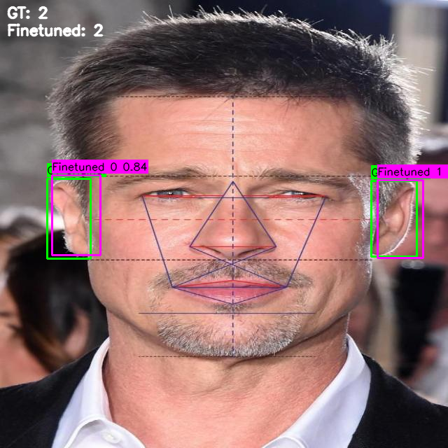
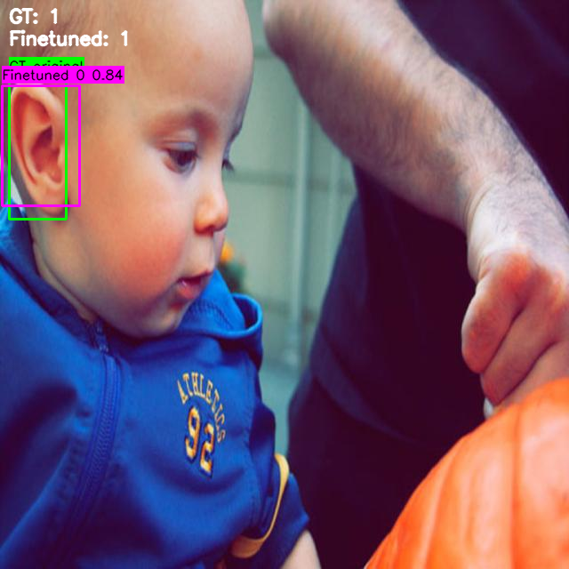
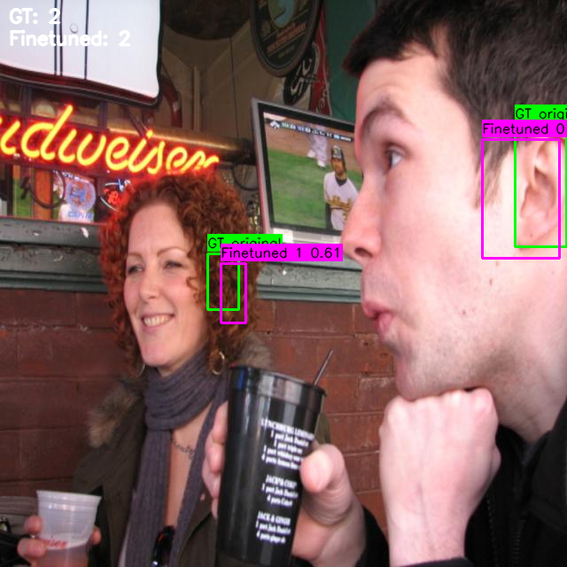
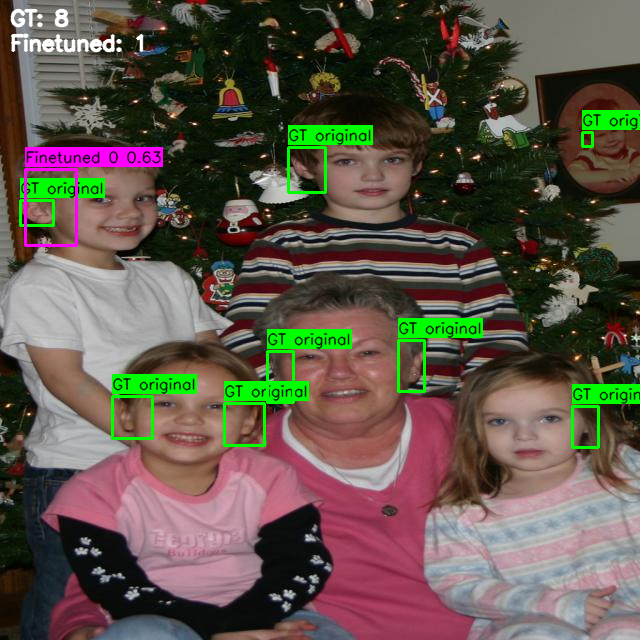
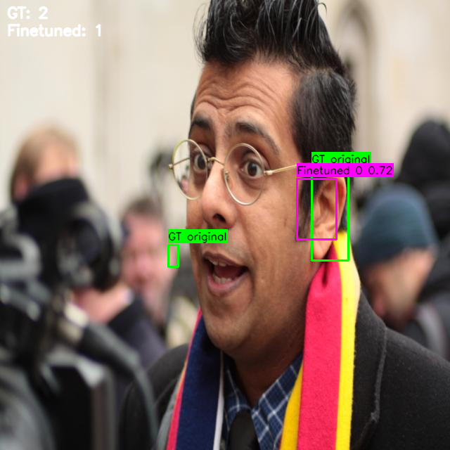
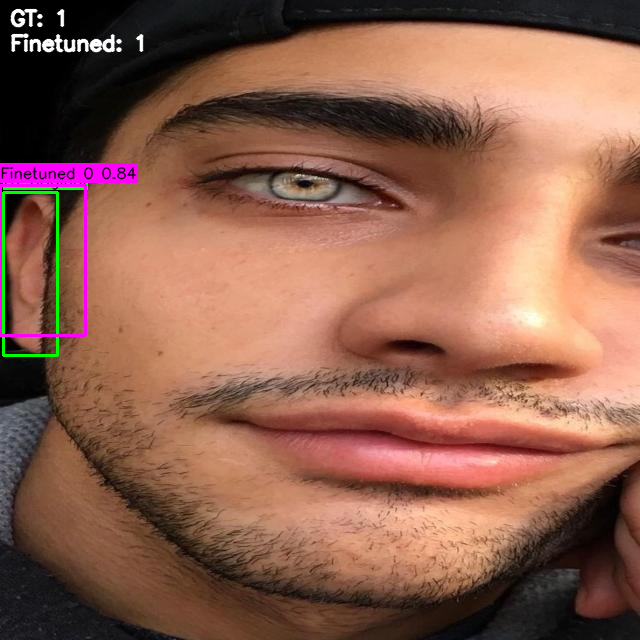

# BlazeEar


**[Live demo](https://shameem4.github.io/BlazeEar/)** &mdash; runs entirely in
your browser, on your device. No image leaves the page.

**Write-ups:**
[Measuring the whole head, privately, in the browser](https://www.linkedin.com/m/pulse/measuring-whole-head-privately-browser-shameem-hameed-ep0mc)
&middot;
[BlazeEar: extending trainable BlazeFace from faces to ears](https://www.linkedin.com/pulse/blazeear-extending-trainable-blazeface-from-faces-ears-shameem-hameed-dalic/)

> Note on the earlier article: it reports a peak validation mAP@0.5 of about
> 0.46 declining to 0.25. Both figures are withdrawn -- they were an artifact
> of an unshuffled validation prefix ordered by annotation source. See
> [v2: what changed](#v2-what-changed-and-what-it-was-worth) for the
> corrected numbers and how they were measured.

BlazeEar is a lightweight ear detector built on the MediaPipe BlazeFace family of models. The goal is practical ear localization in unconstrained images (profiles, partial occlusions, mixed lighting) with a compact architecture that can run in real time on consumer GPUs and edge devices.

The project started as an experiment to reuse BlazeFace’s anchor layout and training recipe for a different small target (ears). Early versions relied on external detectors to generate pseudo‑labels; the current codebase supports a full pipeline from heterogeneous annotations to a trained BlazeEar model, with optional staged fine‑tuning and tooling for qualitative inspection.

---

## Motivation and Evolution

### Initial phase

- Many open ear datasets are small, biased, or inconsistently annotated.  
- BlazeFace provides a proven, low‑latency detector with a fixed 896‑anchor layout.  
- The first iteration focused on “can BlazeFace anchors + loss learn ears at all?”, using automatic boxes from a YOLO ear detector and pose keypoints to bootstrap training data.

### Current state

- A unified data preparation pipeline merges multiple annotation sources into a single CSV with provenance.  
- The BlazeEar model is a BlazeFace‑style front detector (256×256 input) with ear‑specific training, hard negative mining, and focal loss (on by default). The architecture is MediaPipe's; only the input resolution differs, and the parameter count is identical at either size.  
- Debug and visualization scripts help compare BlazeEar to baseline detectors and export sample predictions.

---

## Lineage: Trainable BlazeFace → BlazeEar

This repository is a direct descendant of the sibling project `trainable_blazeface/` (one folder above this repo). That earlier work solved a specific technical problem: MediaPipe’s published BlazeFace weights are “inference‑only”. BatchNorm statistics are folded into convolution weights and the TensorFlow Lite graph cannot backpropagate. `trainable_blazeface` reintroduced trainable BatchNorm into the BlazeBlocks, unfolded the pretrained parameters into those layers, and verified that the PyTorch model produces the same outputs as MediaPipe at initialization.

Once BlazeFace was trainable end‑to‑end, it became a stable platform for adapting the detector to other small, roughly face‑adjacent targets. Ears are similar enough to faces to benefit from the same anchor pyramid and receptive fields, but different enough to expose the limitations of existing ear datasets and off‑the‑shelf detectors.

> **Correction (v2).** Until the v2 branch, `BlazeEar` built its entire backbone
> from `BlazeBlock_WT` — the *folded* block, with BatchNorm baked into the conv
> weights. `BlazeBlock`, the trainable-BatchNorm block this lineage exists to
> provide, was never instantiated, so the shipped model had **no normalization
> layers at all** and the central claim below was not true of it. Worse, the
> conversion path was unreachable: `load_mediapipe_weights` chose it inside an
> `except RuntimeError`, but `load_state_dict(strict=False)` does not raise on
> missing keys, so loading into a BatchNorm backbone reported success while
> leaving 160 keys missing. Both are fixed; eval-mode parity with the folded
> model at initialization is now 1.2e-4 relative.

What carried over unchanged:

- The front‑detector backbone, two‑scale heads, and 896‑anchor layout.  
- The training recipe from `vincent1bt/blazeface‑tensorflow`: anchor target encoding, hard negative mining, and SmoothL1 regression.  
- Weight initialization via `load_mediapipe_weights()` and the same preprocessing/NMS conventions.

What changed to become BlazeEar:

- `blazeface.py` became `blazeear.py` with identical topology but a new task label.  
- `data_prep.py` expanded from “single‑format face boxes” to a multi‑source ear annotation merger with provenance and optional pseudo‑labeling.  
- Training defaults and debug tooling shifted to ear‑specific thresholds and failure modes.

In short: `trainable_blazeface` made BlazeFace trainable; BlazeEar uses that foundation to address ear localization with a purpose‑built dataset pipeline and training run.

---

## Repository Structure

- `blazebase.py`  
  Core BlazeBase utilities: preprocessing, anchor generation, TFLite‑compatible padding, and MediaPipe weight loader.
- `blazedetector.py`  
  Base detector class with MediaPipe preprocessing, batched inference, NMS, and a `get_training_outputs()` path that bypasses post‑processing.
- `blazeear.py`  
  BlazeEar architecture. Anchor count follows the input size: 3584 at the shipped 256 px (2048 from 32×32×2 + 1536 from 16×16×6), 896 at 128 px (512 from 16×16×2 + 384 from 8×8×6). Regressor outputs 16 coords per anchor (4 box + 6 keypoints ×2), though only box coords are supervised by default.
- `train_blazeear.py`  
  Full training pipeline: CSV/NPY dataloading, anchor target encoding, loss, metrics, mixed precision, checkpointing, and TensorBoard logging.
- `data_prep.py`  
  Annotation unification and split generation. Merges COCO/CSV/PTS/LFPW and optional automatic sources (YOLO ear detector, pose ears). Produces `data/splits/train.csv` and `data/splits/val.csv`.
- `dataloader.py`  
  CSV dataset with resize‑pad to square, strong augmentations, and encoding into BlazeFace anchors via `utils/anchor_utils.py`.
- `loss_functions.py`  
  `BlazeEarDetectionLoss`: hard negative mining + BCE or focal classification + SmoothL1 regression.
- `measure_tragion_coverage.py`, `measure_crop_shift.py`,
  `measure_anchor_budget.py`  
  Standalone measurements behind claims in this README, kept runnable so the
  numbers can be rechecked rather than trusted: whether the face stage's
  predicted tragions land on the ears that escape the crop (they do not), what
  a same-size shifted crop could recover (5.1pp, given a direction), and where
  the anchor budget goes against where the ears actually are.
- `utils/`  
  Anchor helpers, augmentations, visualization, metric utilities, debug scripts, and tests.
- `runs/`  
  Training artifacts. `runs/checkpoints/` contains saved `.pth` weights, and `runs/logs/` holds TensorBoard events and debug screenshots.

---

## Architecture

BlazeEar matches the MediaPipe BlazeFace front detector topology. The network is a small two‑stage BlazeBlock backbone followed by two detection heads operating at different strides.

```text
Input RGB image (H×W×3)
        │
        ▼
Resize + pad to square
Resize to 256×256
        │
        ▼
Conv 5×5 s=2, 24ch
        │
        ▼
Backbone1: BlazeBlock stack
  → feature map 16×16×88
        │
   ┌────┴─────────────┐
   │                  │
   ▼                  ▼
Classifier_8          Regressor_8
16×16 grid            16×16 grid
2 anchors/cell        2 anchors/cell
512 scores            512 box+kp preds
   │                  │
   └──────┬───────────┘
          │
          ▼
Backbone2: BlazeBlock stack
  → feature map 8×8×96
          │
   ┌────┴─────────────┐
   │                  │
   ▼                  ▼
Classifier_16         Regressor_16
8×8 grid              8×8 grid
6 anchors/cell        6 anchors/cell
384 scores            384 box+kp preds
   │                  │
   └──────┬───────────┘
          │
          ▼
Concat across scales
  scores: (896, 1) logits
  boxes:  (896, 16) raw coords
          │
          ▼
Decode + sigmoid + NMS
→ final ear detections
```

Anchor pyramid:

- Small scale: 16×16 grid with 2 anchors per cell (512 anchors).  
- Large scale: 8×8 grid with 6 anchors per cell (384 anchors).  
- Total: 896 anchors, each predicting 1 class score and 16 regression values (4 box + 12 keypoint coords).

Anchor priors are fitted to the ear box statistics rather than inherited from
MediaPipe. The original anchors were all `w = h = 1.0`, so the 896 anchors
covered only 320 distinct positions with no scale or aspect prior at all;
measured over 13477 human boxes, the closest anchor reached IoU 0.5 for 0.1% of
ears. MediaPipe's own variable-size anchors reach 18.0%, and priors fitted by
k-means reach 23.8%. Even fitted, most ears never reach IoU 0.5, because the
limit is spatial — stride 8 spaces anchor centres 0.0625 apart for objects
0.053 wide — so targets are assigned best-match per box rather than by an IoU
threshold. A stride-4 head would raise that to 57.6% and is the largest
remaining architectural gain.

---

## Pipeline Dataflow

End‑to‑end flow from raw data to a trained model:

```text
Raw datasets under data/raw/
  COCO / CSV / PTS / LFPW
        │
        ▼
data_prep.py
  - decode annotations
  - optional YOLO ear boxes
  - optional pose ear keypoints
  - merge + de‑duplicate
        │
        ▼
master.csv (with annotation_source)
        │
        ├───────────────┐
        ▼               ▼
train.csv           val.csv
        │               │
        ▼               ▼
CSVDetectorDataset (dataloader.py)
  - load image
  - resize/pad to 256×256
  - augment (color + geometry + occlusion)
  - normalize boxes
  - encode to anchors (utils/anchor_utils.py)
        │
        ▼
train_blazeear.py
  - get_training_outputs()
  - BlazeEarDetectionLoss
  - hard negative mining
  - AMP / freeze‑thaw optional
        │
        ▼
runs/checkpoints/*.pth
runs/logs/BlazeEar/*
        │
        ▼
utils/debug_training.py
  - qualitative screenshots
  - metric sweeps / comparisons
```

---

## Installation

1. Create an environment (Python 3.10+ recommended).
2. Install dependencies:

```bash
pip install -r requirements.txt
```

Notes:

- Training and debug scripts expect PyTorch and Ultralytics.  
- CUDA is optional but strongly recommended for training.

---

## Data Preparation

Raw data should live under `data/raw/` in any of the supported formats. The prep script walks subfolders, decodes annotations, and produces a single metadata table.

```bash
python data_prep.py \
  --data-root data/raw \
  --output-csv data/splits/master.csv \
  --train-csv data/splits/train.csv \
  --val-csv data/splits/val.csv
```

Key behaviors:

- Supports COCO JSON, CSV, PTS, and LFPW TXT formats via `utils/data_decoder.py`.  
- Optional pseudo‑labeling with Ultralytics YOLO and ear keypoints from a pose model.  
- Each box records an `annotation_source` value (e.g., `GT`, `EAR`, `POSE`, `GT+EAR`) to preserve provenance.

---

## Training BlazeEar

The primary path is CSV training that mirrors the MediaPipe front detector setup:

```bash
python train_blazeear.py --csv-format \
  --train-data data/splits/train.csv \
  --val-data data/splits/val.csv \
  --data-root data/raw
```

Useful flags:

- `--init-weights mediapipe-backbone|mediapipe|scratch`  
  Default `mediapipe-backbone` loads the backbone and re-initializes the
  detection heads with a background prior. MediaPipe's head is calibrated for
  the folded backbone's activation scale, and trainable BatchNorm renormalizes
  the features under it: inherited, it starts at a median logit of -339 on
  anchors holding an ear. Re-initialized, -4.8.
- `--freeze-thaw`  
  Staged training: heads only → backbone2 → full model (see script defaults).
- `--no-focal-loss`  
  Fall back to BCE. **Focal loss is the default**, not an opt-in:
  `train_blazeear.py` calls `parser.set_defaults(use_focal_loss=True)`, so
  every run in this repository's history trained with it unless this flag was
  passed. The CLI defaults are `--focal-alpha 0.35 --focal-gamma 1.5`; the
  `0.25 / 2.0` pair is `BlazeEarDetectionLoss`'s own signature default, which
  the trainer overrides and which therefore never reaches a training run.
  An earlier version of this section documented `--use-focal-loss` as the way
  to switch focal loss on, with the `0.25 / 2.0` figures -- both wrong.
- `--amp / --no-amp`  
  Mixed precision toggle.
- `--resume runs/checkpoints/BlazeEar_epochXX.pth`  
  Resume from an explicit checkpoint.

Outputs:

- Checkpoints in `runs/checkpoints/` (best model at `runs/checkpoints/BlazeEar_best.pth`).  
- TensorBoard logs in `runs/logs/BlazeEar/`.

To view logs:

```bash
tensorboard --logdir runs/logs
```

---

## Training Results

> **These figures were withdrawn.** The v2 branch found the measurement that
> produced them to be wrong in several independent ways, and the model is being
> retrained. Nothing below should be cited until that finishes.

The previously reported "peak validation mAP@0.5 ≈ 0.46, declining to ≈ 0.25"
was **a measurement artifact, not a training dynamic**. Per-epoch validation
scored `200 // batch_size` batches while the final summary scored
`500 // batch_size`, and `val.csv` preserved master-CSV row order, which is
source-by-source — so a short prefix sampled one easy dataset. Holding the
epoch-94 checkpoint completely fixed and varying only how many validation
images are scored reproduces the whole "decline":

| val images scored | mAP@0.5 |
| --- | --- |
| 96 | 0.5508 |
| 192 | 0.4286 |
| 480 | 0.2497 |
| 2022 (all) | 0.2801 |

The metric itself was also non-standard: VOC07 11-point AP computed per image
and averaged, on images holding one or two boxes, which measures quantization
more than detection. Pooled properly over the whole split, that same checkpoint
scores **mAP@0.5 = 0.149**, or **0.213** against human-verified labels only.
Around 38% of validation boxes were pose-model pseudo-labels that no detector
reproduces — 97.8% of them have zero overlap with any human box.

Corrected numbers will be published here after the retrain.

Qualitative samples are exported to `runs/logs/debug_images/`. These PNGs show predicted boxes over diverse poses and occlusions and are useful for spotting failure modes (small ears, heavy occlusion, extreme profiles).

Examples (from this run):













---

## Inference and Debugging

The simplest programmatic usage:

```python
from blazeear_inference import BlazeEarInference

pipeline = BlazeEarInference(
    weights_path="runs/checkpoints/BlazeEar_best.pth",
    device="cuda",
)

# img: numpy HxWx3 RGB
dets = pipeline.predict(img)  # (N, 5) [ymin, xmin, ymax, xmax, score] in image space
```

`BlazeEarInference` accepts both checkpoint layouts (a bare state dict, or a
training checkpoint with the weights under `model_state_dict`). To drive the
bare model instead, unwrap the checkpoint yourself and build the anchors after
moving the model to its device:

```python
import torch
from blazeear import BlazeEar
from utils.anchor_utils import anchor_options

model = BlazeEar()
checkpoint = torch.load("runs/checkpoints/BlazeEar_best.pth", map_location="cpu")
model.load_state_dict(checkpoint["model_state_dict"])
model.to("cuda").eval()
model.generate_anchors(anchor_options)

dets = model.process(img)  # returns boxes in original image space
```

Note: `load_weights()` only handles a bare state dict, so it cannot load the
`.pth` files written by `train_blazeear.py` directly.

Utilities:

- `utils/image_demo.py` and `utils/webcam_demo.py`  
  Run BlazeEar on images or webcam streams.
- `utils/debug_training.py`  
  Compare BlazeEar vs MediaPipe weights, dump debug screenshots, and run quick eval loops.

Example screenshot export:

```bash
python utils/debug_training.py \
  --weights runs/checkpoints/BlazeEar_best.pth \
  --data-root data/raw \
  --csv data/splits/val.csv \
  --screenshot-count 20
```

---

## Optional: YOLO auto-labelling (not distributed)

A fine-tuned YOLOv11 detector was used to propose ear labels while building
`data/splits/*.csv`. Neither the datasets nor the splits are distributed here
(`/data` is gitignored), so none of this is needed to run or evaluate the
shipped model.

The tooling itself is **not in this repository**: `finetune_yolov11.py`,
`utils/yolo11_demo.py` and `model_weights/yolov11_ear_detector.pt` depend on
[Ultralytics](https://github.com/ultralytics/ultralytics), which is
**AGPL-3.0** and cannot be redistributed under Apache-2.0. See
[NOTICE](NOTICE).

`data_prep.py` and `relabel.py` ship with optional YOLO paths that import
Ultralytics lazily, so both files work without it installed. To re-run label
proposal you would install Ultralytics yourself and accept its terms:

```bash
pip install "ultralytics>=8.2.0"
python relabel.py propose --weights <your-yolo-weights.pt> ...
```

---

## Testing

Unit tests live under `utils/tests/`.

```bash
pytest
```

---

## Export to ONNX

This repo includes a small helper script that exports the training checkpoint format
(`model_state_dict` inside the `.pth`) to an ONNX graph.

```bash
# Needed for the torch.export-based exporter:
pip install onnx onnxscript
# Needed to check the exported graph against the model:
pip install onnxruntime

python export_onnx.py \
  --checkpoint runs/checkpoints/BlazeEar_best.pth \
  --output runs/checkpoints/BlazeEar_best.onnx
```

Every export is then run through ONNX Runtime and compared against the PyTorch
model it came from; the script refuses a graph that disagrees. `--no-check`
skips the comparison, and it is skipped with a warning if `onnxruntime` is not
installed. Exporting without checking is how a graph that is quietly wrong gets
shipped, so prefer leaving the check on.

Note on opsets: PyTorch 2.9 made the `torch.export`-based exporter the default
and dropped the `fallback` argument that used to reach the legacy
TorchScript exporter, so the old `--no-fallback` flag is gone. That exporter
implements opset 18 upwards and keeps 18 when it cannot down-convert a node --
this model's `Pad` has no opset 17 adapter -- so `--opset` defaults to 18.
Asking for 17 produces a noisy conversion failure and an opset 18 graph anyway.

(`export_two_stage_web.py`, which writes the `docs/*.onnx` graphs the browser
demo loads, deliberately still calls the legacy exporter at opset 17, because
ONNX Runtime Web is the consumer there.)

The exported model takes `image: (N, 3, 256, 256)` and returns:

- `raw_boxes: (N, 3584, 16)`
- `raw_scores: (N, 3584, 1)` (logits)

To export an ONNX model that includes post-processing (decode + NMS) and returns final detections:

```bash
python export_onnx.py \
  --postprocess \
  --checkpoint runs/checkpoints/BlazeEar_best.pth \
  --output runs/checkpoints/BlazeEar_best_post.onnx
```

`detections` is `(num_detections, 5)` in `[ymin, xmin, ymax, xmax, score]` (normalized coords).

The check is weaker for `--postprocess`: it probes with random noise, which
normally scores below the threshold, so decode and NMS see no box and the
script says as much rather than reporting a pass. Export without
`--postprocess` to check the network, and check the postprocessing graph on a
real image.

`export_onnx.py` inspects the checkpoint and builds the matching architecture,
so pre-BatchNorm checkpoints still export.

### Exporting the two-stage pipeline for the browser

```bash
python export_two_stage_web.py
```

This writes `docs/BlazeFace_web.onnx` and `docs/BlazeEar_web.onnx`, then runs
each graph against the PyTorch model it came from and refuses to ship one that
disagrees. The two graphs carry different anchors -- MediaPipe's squares and
the fitted ear priors -- each baked into its own graph, because decoding either
through the other's anchors gives boxes at the wrong scale rather than an
error. See `docs/README.md` for the JavaScript side.

---

## Evaluation

`evaluate.py` scores a checkpoint over a whole split, pooling every detection
into one precision/recall curve rather than averaging per-image AP, and breaks
the result out by annotation provenance so pseudo-label agreement is never
folded into the headline number.

```bash
python evaluate.py --checkpoint runs/checkpoints/BlazeEar_best.pth
```

Boxes from an untrusted source are scored as ignore regions in the other views,
so excluding them does not turn a correctly-detected ear into a false positive.
Checkpoints predating the v2 anchor change need `--legacy-anchors`.

## Test-time augmentation

The two-stage pipeline can detect each ear through several nuisance-perturbed
crops and fuse the agreeing boxes. The ear never moves between views, so the
spread between those detections is the model's own noise, and fusing cancels
part of it. Views are `(expand, flip)` pairs in `utils/tta.py`, mirrored in
`docs/blazeear_inference.js` and pinned against each other by
`utils/tests/tests/test_tta.py`.

```bash
python evaluate_two_stage.py --csv data/splits/common_heldout.csv \
  --data-root data/raw \
  --crop-checkpoint model_weights/BlazeEar_best_256px.pth --tta 4
```

**The tables in this section were measured on the 128 px model**, which is what
TTA was developed against; they are kept because the conclusions about fusion
(the rule, the suppression, the view count) are what they establish, and those
carry over. For how TTA interacts with the shipped 256 px model -- the short
version is that resolution absorbs most of the gain -- see
[the 256 px section](#the-256-px-input-shipped).

Measured on the 279-image common held-out set at 128 px, against the same
checkpoint, with a paired bootstrap over 2000 resamples of the images:

| views | mAP@0.5 | mAP@[.5:.95] | det IoU | paired gain, mAP@0.5 |
|---|---|---|---|---|
| 1 (no TTA) | 0.5809 | 0.2445 | 0.7193 | --- |
| 2 | 0.6078 | 0.2565 | 0.7258 | +0.0240 [-0.0018, +0.0533] |
| 4 | 0.6299 | 0.2776 | 0.7284 | +0.0467 [+0.0191, +0.0788] |

Only the four-view interval excludes zero, so four views is the configuration
worth running; at two the gain is real-looking but not separable from noise on
a set this size. It costs one full ear-model pass per view per face, and the
face stage still runs once per frame regardless: 2.55 ms per view at 128 and
7.72 ms at 256, on one CPU thread.

Six and eight views were then measured against the shipped four, extending the
pattern with flips of the two scale views and a wider scale pair:

| views | mAP@0.5 | mAP@[.5:.95] | det IoU | paired gain vs 4 views, mAP@0.5 |
|---|---|---|---|---|
| 6 | 0.6402 | 0.2826 | 0.7325 | +0.0102 [-0.0076, +0.0282] |
| 8 | 0.6346 | 0.2868 | 0.7338 | +0.0039 [-0.0172, +0.0242] |

Both intervals straddle zero and mAP@0.5 is not even monotonic -- six views
beats eight -- so four stands. `VIEWS` therefore holds four entries, and
`--tta N` above that is now an error: `VIEWS[:N]` silently returns the whole
list, so `--tta 8` had been running four views and reporting success.

Two findings are worth repeating because both cost a measurement to find:

- A fused box takes the **highest** score among its members. Scoring it as
  sum-over-view-count instead demotes real ears that only one view found; at
  two views that rule scored *below* no TTA at all (0.5530 against 0.5809).
- Fusion clusters at a looser overlap than the pipeline's NMS, so the fused set
  must go through NMS afterwards as well. Without it, more views simply emit
  more boxes: 7 / 12 / 17 detections for 1 / 2 / 4 views on a two-face image in
  the browser, against 7 / 7 / 11 once suppression was added.

Both of those were found by running the browser pipeline against the real ONNX
graphs, and so was the anchor-count bug that the move to 256 exposed: the
browser read a hardcoded `numAnchors = 896` from a graph now emitting 3584, so
it saw only the top fourteen rows of the grid. Nothing threw -- the tensor is
simply longer than the loop -- and the whole Python suite passed. It showed up
as detections at confidence 0.32 where Python got 0.96. The count now comes
from the output tensor. **A JS change is not verified by the Python tests**;
the parity worth checking is one image through both paths, which should agree
to a fraction of a pixel (canvas and cv2 resample slightly differently).

The browser pipeline runs four views by default; pass `{views: 1}` to
`createTwoStageDetector` for the single-crop behaviour.

### TTA needs its own score threshold

mAP sweeps the entire score range, so it says nothing about the single
threshold a deployment actually sits at -- and fusion moves the score
distribution, because a fused box takes its best member's score. Sweeping the
operating point on the same held-out set, at IoU 0.5:

| threshold | plain F1 | TTA 4 F1 |
|---|---|---|
| 0.70 (the old shared value) | 0.6212 | 0.5824 |
| 0.80 | **0.6646** | 0.6533 |
| 0.85 | 0.6575 | **0.6864** |
| 0.90 | 0.5790 | 0.6884 |

So the inherited 0.70 was wrong for both paths, and **at 0.70 turning TTA on
was a measured regression**: -0.0389 F1 against no TTA (95% CI [-0.0649,
-0.0123]), while still gaining +0.0467 mAP@0.5. A ranking gain and an
operating-point loss are not in conflict; they are different questions, and
only the first had been asked. Recalibrating TTA to its own threshold is worth
+0.1054 F1 (95% CI [+0.0715, +0.1404]) -- the largest confirmed gain here, and
it is a constant, not a model.

`DETECTION_SCORE_THRESHOLD` is now 0.80 and `TTA_SCORE_THRESHOLD` 0.85, mirrored
in the browser pipeline and pinned by `test_tta.py`. TTA takes 0.85 rather than
its argmax 0.90 because F1 is flat over 0.85-0.90 and then falls off a cliff
(0.666 at 0.91); the plateau centre is the safer place to sit. With both paths
at their own best, TTA's F1 edge is +0.0234 [-0.0028, +0.0496] -- not
distinguishable. TTA buys ranking quality, not a better operating point.

## Relabelling

Most images here carry exactly one human-labelled ear (11084 of 13482), so the
second ear is usually present but unlabelled — and hard negative mining selects
the highest-scoring background anchors, which is precisely that ear.
`relabel.py` closes the gap with human review rather than more pseudo-labels:

```bash
python relabel.py propose --weights <labeller>/best.pt
python relabel.py review
python relabel.py apply --output data/splits/master_relabelled.csv
```

A reviewer can also mark a real ear whose box is wrong (queued for correction,
never merged) or one too degraded to learn from (merged as an ignore region, so
it is neither a target nor a hard negative).

---

## v2: what changed, and what it was worth

The v2 branch set out to fix correctness problems and ended up changing the
architecture, because the measurements kept pointing at the same thing.

### The headline

Every checkpoint below is scored through one identical detection path, on the
**279 images (355 ears, 12 sources) that no model in this repo's history ever
trained on**. That set matters: the splits changed during v2, and 85.3% of the
current validation images sit inside the *original* model's training set, so
the obvious comparison would have measured memorisation.
`make_common_heldout.py` builds it, using content-hash photo identity rather
than filenames, because one photo appears under several Roboflow hashes.

| model | mAP@0.5 | mAP@[.5:.95] | detection IoU |
|---|---|---|---|
| original (pre-v2) | 0.1790 | 0.0421 | 0.6189 |
| v2 single-stage | 0.3142 | 0.0938 | 0.6558 |
| **v2 two-stage** | **0.5809** | **0.2445** | **0.7193** |

**3.2x on mAP@0.5, 5.8x on mAP@[.5:.95].** On the full 2021-image validation
split the two v2 models read 0.3561 and 0.6447.

All two-stage figures are at the shipped face threshold of 0.2. That value was
chosen by sweeping the validation split, so it is worth saying that the
held-out set above is independent of that sweep and agrees: 0.5760 at 0.3,
0.5809 at 0.2.

Two honest caveats. 279 images is a small set -- treat a few points as noise,
not the 3x. And the gain is not purely architectural: v2 also relabelled the
data, and the evaluation ground truth is the relabelled set the original never
trained against. Separating those would need the original design retrained on
the new labels.

### The architecture change

The single biggest finding was a structural one. The median ear is **6.8 x 14.0
px** once a full frame is squeezed into the 128x128 input, and **65.7% of ears
are smaller than BlazeFace's smallest anchor**. The model was being asked to do
something its anchor geometry could not express.

MediaPipe does not work this way. Its pipelines run a coarse detector on the
full frame and a fine model on a crop around each hit. Restoring that pattern
-- BlazeFace, then a square crop at 1.5x the face box, then the ear model --
raises the median ear to 32.5 px and accounts for most of the gain above.

Stage one is MediaPipe's published BlazeFace weights, unmodified. Nothing about
this deviates from MediaPipe; the original design had simply collapsed a
two-stage pattern into one stage.

The cost is a recall ceiling: an ear the pipeline never shows the second stage
cannot be found. Measured per ear, 11.3% are unreachable -- 2.5% because no
face was detected, and 8.7% because the ear fell outside every crop window
despite a face being found (see
[the ceiling section](#the-recall-ceiling-is-crop-geometry-not-face-detection)).
All of that is charged honestly in every number above -- those ears count as
misses rather than leaving the denominator. A full-frame fallback on those images was
measured and is a wash, because the ears it would have to find there are a
median 4.4 px.

See `make_face_crops.py`, `evaluate_two_stage.py`, and the P7 section of
`V2_PLAN.md`.

### Correctness fixes that came first

None of this would have been measurable without fixing the measurement. In
rough order of how much they mattered:

- **The published "mAP 0.46 peak, declining to 0.25" was an artifact.** The
  same fixed checkpoint reads 0.5508 / 0.4286 / 0.2497 / 0.2801 as the
  validation prefix grows through 96 / 192 / 480 / 2022 images, because the
  prefix was unshuffled and ordered by annotation source. Both figures are
  withdrawn.
- **A validation loop that scored one image.** Overlapping edits left the loop
  body only reassigning variables, so everything after it ran once on the final
  batch. Every validation number for a stretch of v2 was wrong.
- **`load_mediapipe_weights` had a conversion path that never executed** --
  160 missing keys, reported as success.
- **73.5% of positive anchors sat inside `torch.clamp`'s exact-zero-gradient
  dead zone** (median logit -1047).
- **`augment_face_cutout` erased the ear entirely in 120 of 200 seeds** while
  keeping the positive label.
- **The geometry filter rejected 25.86% of real ears**, and ran in one of four
  inference paths.
- **Duplicate photos straddled the split.** Content hashing moved 121 photos
  to one side; 4.1% of the corpus is duplicate files.
- **POSE pseudo-labels are junk**, not a rescalable convention: 97.8% have zero
  overlap with human boxes. They are ignore regions now.
- **Hard-negative mining was starved** by a default of 1.5, giving 10 negatives
  out of 894.

### Consolidation

- **Five NMS implementations became one.** They disagreed on the boundary case
  and ran at three different IoU thresholds, so every reported mAP described
  post-processing nothing deployed. Replacing the trainer's Python loop over
  CUDA tensors also cut a validation pass from **50.4s to 8.9s at identical
  mAP**.
- **The test runner passed by not looking.** It drove `unittest` discovery over
  a mostly pytest-style suite, reporting `Ran 51 tests ... OK` while `pytest`
  ran 336. It delegates to pytest now.
- Detection thresholds, the anchor count and grid sizes have one definition
  each in `utils/config.py`, with a raise if the built anchor count ever
  disagrees.

Tests went from 41 to 344.

### Reproducing the comparison

```bash
python make_common_heldout.py

python evaluate_two_stage.py \
  --csv data/splits/common_heldout.csv \
  --checkpoint runs/checkpoints/BlazeEar_best.pth --legacy-anchors

python evaluate_two_stage.py \
  --csv data/splits/common_heldout.csv \
  --checkpoint runs/checkpoints_v2/BlazeEar_best.pth \
  --crop-checkpoint model_weights/BlazeEar_best_256px.pth
```

The two `runs/` checkpoints above are local training output and are not
distributed (`/runs` is excluded from version control); only the two crop
models in `model_weights/` ship.

`--legacy-anchors` is needed for the pre-v2 checkpoint: it was trained against
the original `w=h=1.0` squares, and decoding it through the fitted ear priors
gives boxes at the wrong scale rather than an error. Those checkpoints also
predate the 256 px input, so they need `--input-size 128`.

### Building the face-crop dataset

```bash
python make_face_crops.py --keep-empty-crops
python split_face_crops.py
python train_blazeear.py \
  --train-data data/splits/crops_train.csv \
  --val-data data/splits/crops_val.csv \
  --data-root data/face_crops/ \
  --checkpoint-dir runs/checkpoints_crop --log-dir runs/logs_crop
```

`--keep-empty-crops` matters: 29.6% of face crops contain no visible ear, and
training without them leaves the model never having seen a face whose ears are
hidden while being handed exactly that a third of the time at inference.

## License

Apache License 2.0 &mdash; see [LICENSE](LICENSE) and [NOTICE](NOTICE).
This replaces the earlier CC BY-NC 4.0 terms, so commercial use is now
permitted.

**The code, the architecture and the trained weights are Apache-2.0.**

The sample photographs are not, and are not meant to be. They are
illustrations of model output: dataset photographs with detection boxes drawn
over them, used to show what the detector does. They keep their original
authors' Creative Commons terms, credited in [NOTICE](NOTICE):

- Seven are from [Open Images](https://storage.googleapis.com/openimages/web/index.html),
  licensed by their photographers under
  [CC BY 2.0](https://creativecommons.org/licenses/by/2.0/), each listed by
  its Open Images ID.
- Two are from
  [*ear annotations.*](https://universe.roboflow.com/annotations-rzsmp/ear-annotations)
  by Roboflow user `annotations-rzsmp`, licensed
  [CC BY 4.0](https://creativecommons.org/licenses/by/4.0/).

All nine are **modified** &mdash; bounding boxes and score labels were drawn
on &mdash; which CC BY requires be stated, and [NOTICE](NOTICE) states it.

The training data is not distributed: `/data` is excluded from version
control, so no dataset images or annotations are redistributed. The YOLO
auto-labelling tooling is AGPL-3.0 and is not distributed either (see below).

BlazeEar derives from [MediaPipe](https://github.com/google-ai-edge/mediapipe)
BlazeFace, which is also Apache-2.0, and the two-stage pipeline runs
MediaPipe's published BlazeFace weights unmodified as its first stage.

The YOLO auto-labelling tooling that depends on
[Ultralytics](https://github.com/ultralytics/ultralytics) is **AGPL-3.0**, so
it is not distributed here: `finetune_yolov11.py`, `utils/yolo11_demo.py` and
`model_weights/yolov11_ear_detector.pt` are excluded from version control, and
`ultralytics` is not in `requirements.txt`. The optional YOLO paths that do
ship, in `data_prep.py` and `relabel.py`, import it lazily and are not
reachable without installing it yourself. Nothing in the BlazeEar model, its
training, its evaluation, or the browser demo needs it. See [NOTICE](NOTICE).

## Next Directions

Areas that naturally follow from the current pipeline:

- Add explicit ear keypoint supervision if labels become available (regressor heads already exist).  
- Calibrate detection thresholds per operating point. The shared defaults
  are now fitted rather than inherited (see above); what remains is a
  front-facing vs profile split, which needs those subsets labelled. Note
  that the *size* axis of this is already closed -- a per-size gate was
  swept and has no headroom, because the ranking inside each band is fine
  and the base rate is not. See "The score head discards ears it has
  already localised".
- Widen `augment_scale`'s low end from 0.75 to about 0.35, so the training
  distribution reaches the size band the model is worst at. One line, 1-3
  GPU-hours, untested; the reasoning is in the score-head section below.
- Cap hard-negative mining per feature level. 57% of the anchor budget
  currently takes global mining pressure while receiving 7.7% of the
  positives. Same section.
- Export to ONNX/TFLite for edge deployment.
- Price 320 px. 256 paid, the grid argument keeps scaling, and the
  anchor machinery is now size-parameterised, so the run is a constant
  change -- but CPU grows as the square and 3.0x is already the headline
  cost of 256.

### The 256 px input (shipped)

The network is fully convolutional, so the MediaPipe weights load unchanged at
any input size and only the spatial grids grow. At 256 px the stride-8 head
becomes 32x32 and the stride-16 head 16x16, so the anchor set goes 896 -> 3584
and anchor centres sit 0.03125 apart instead of 0.0625. The priors need no
refit: they are normalized to the input, so the same prior simply lands on a
finer grid. **Nothing about the architecture, the parameter count or the
two-stage pipeline changes.**

This is the shipped configuration. The face stage stays at 128 -- those are
MediaPipe's weights at their own input size -- so both sizes exist in one
process, and input size is therefore a `BlazeEar` constructor argument rather
than only a module constant. `FACE_INPUT_SIZE` pins the face stage explicitly;
inheriting `DEFAULT_INPUT_SIZE` there would hand the face weights a 256 px
input and a 3584-anchor decode.

Retrained at 256 with the same data, initialisation, hyperparameters and 100
epochs. Both checkpoints ship, so every figure below is reproducible:
`model_weights/BlazeEar_best_128px.pth` and
`model_weights/BlazeEar_best_256px.pth`.

#### 128 against 256, every way it was measured

Three measurements, because they answer different questions and do not agree in
magnitude. **Read the path label before comparing any two numbers here** -- the
two crop-space paths differ by 0.03 mAP@0.5 on the *same* checkpoint, and
mixing them cancelled this entire effect on the first attempt.

| measurement | 128 | 256 | delta |
|---|---|---|---|
| **crop-space, deployed path** (`crops_val`, 2193 ears) | | | |
| &nbsp;&nbsp;mAP@0.5 | 0.7426 | **0.7783** | +0.0357 |
| &nbsp;&nbsp;mAP@[.5:.95] | 0.3405 | **0.3596** | +0.0191 |
| &nbsp;&nbsp;det IoU | 0.7338 | **0.7390** | +0.0052 |
| **crop-space, dataloader path** (`evaluate.py`, same split) | | | |
| &nbsp;&nbsp;mAP@0.5 | 0.7106 | **0.7456** | +0.0350 |
| &nbsp;&nbsp;mAP@[.5:.95] | 0.3246 | **0.3446** | +0.0200 |
| &nbsp;&nbsp;det IoU | 0.7273 | **0.7334** | +0.0061 |
| **end to end, 1 view** (`common_heldout`, 355 ears) | | | |
| &nbsp;&nbsp;mAP@0.5 | 0.5809 | **0.6766** | +0.0957 |
| &nbsp;&nbsp;mAP@[.5:.95] | 0.2445 | **0.2962** | +0.0517 |
| &nbsp;&nbsp;det IoU | 0.7193 | **0.7314** | +0.0121 |
| **end to end, 4 views** (TTA, the browser default) | | | |
| &nbsp;&nbsp;mAP@0.5 | 0.6299 | **0.6961** | +0.0662 |
| &nbsp;&nbsp;mAP@[.5:.95] | 0.2776 | **0.3188** | +0.0412 |
| &nbsp;&nbsp;det IoU | 0.7284 | **0.7412** | +0.0128 |

Paired bootstrap on the deployed crop-space path, 1000 resamples over images:

| paired difference | 95% CI | |
|---|---|---|
| mAP@0.5 +0.0353 | [+0.0210, +0.0499] | real |
| mAP@[.5:.95] +0.0188 | [+0.0089, +0.0281] | real |
| det IoU +0.0052 | [+0.0001, +0.0099] | real, but only just |

Three things in that table are worth more than the headline.

**The end-to-end gain is nearly three times the crop-space gain** -- paired,
+0.0926 mAP@0.5 end to end (95% CI [+0.0557, +0.1306]) against +0.0353
crop-space (95% CI [+0.0210, +0.0499]). The intervals are disjoint, so the
difference between the two measurements is real and not sampling noise.

The mechanism first offered for it was wrong, and the test that refuted it is
below. The guess was that end-to-end crops are smaller, so more of them are
upscaled into the input and crop-space under-samples that. The crop-size
distributions are in fact nearly identical -- median side 237 px for
`crops_val` against 262 px live, with 96.6% against 96.5% of crops above
128 px -- so that is not the explanation. What remains is that `crops_val` and
`common_heldout` are different image sets of very different difficulty (0.7426
against 0.5809 mAP@0.5 at 128 px), and a harder set leaves more for resolution
to recover. That is consistent with the numbers but has not been isolated, and
no mechanism specific to the two-stage pipeline survives.

#### Stratified by face crop size

The crop side is `FACE_CROP_EXPAND` x the face box, and that crop is resized
to the input, so the crop side decides whether the input is discarding real
pixels. The prediction was sharp: a crop below 128 px is upscaled by both
models and 256 cannot recover detail that was never captured, so the gain
should vanish there and concentrate in the large-crop bins.

**It does the opposite.** Each ear is assigned to the smallest crop window
containing its centre -- the best-resolution view the pipeline had of it --
and scored COCO-style, with out-of-bin ears as ignore regions so a detection
on one is neither rewarded nor punished. One view, no TTA, so this is
resolution alone:

| bin | ears | 128 | 256 | delta | 95% CI | |
|---|---|---|---|---|---|---|
| crop <=192 px | 85 | 0.5507 | **0.7364** | **+0.1856** | [+0.0776, +0.2753] | 256 better |
| crop 192-256 px | 68 | 0.7004 | 0.7649 | +0.0645 | [-0.0098, +0.1371] | no difference |
| crop 256-384 px | 86 | 0.6138 | 0.6771 | +0.0633 | [-0.0168, +0.1468] | no difference |
| crop >384 px | 76 | 0.8142 | **0.9060** | +0.0918 | [+0.0113, +0.1809] | 256 better |
| unreachable | 40 | 0.0000 | 0.0000 | --- | --- | neither model, ever |

The gain is positive in every bin and **largest in the smallest-crop bin**,
which is where no gain was predicted. There is no monotonic relationship with
crop size, so preserving real detail is not what 256 is buying -- that would
have produced the opposite ordering.

The standard explanation for this in object detection fits: the heads have a
fixed stride in *model* pixels (8 and 16), so what matters is the object's size
relative to that stride, not its size in real pixels. Upscaling the input makes
a small object cover more cells and overlap more anchors even though it adds no
information. The crop-size table supports that reading -- the ear is a
near-constant ~32 px of model input in every bin, because the crop is
proportional to the face, so the only thing resolution changes is how many
cells that ~32 px becomes. It is not isolated, though: the bins also differ in
baseline difficulty (0.55 to 0.81 at 128 px), and the clean test would vary the
stride rather than the input size.

The `unreachable` row scoring exactly zero in both arms is the check that the
binning is doing what it claims.

**Localisation moves least** -- det IoU gains +0.0052 crop-space, the only
interval here that barely clears zero. Consistent with everything else in this
README: det IoU has been the metric least responsive to every intervention
tried, which is the standing reason to think box tightness needs a bigger model
rather than more work on this one.

**Resolution and TTA overlap**, because both reduce the same localisation
noise. TTA's marginal gain falls from +0.0467 at 128 to +0.0194 at 256
(95% CI [+0.0009, +0.0394] -- still real, but only just on mAP@0.5):

| configuration | mAP@0.5 | mAP@[.5:.95] | det IoU | ear CPU per face |
|---|---|---|---|---|
| 128, 1 view | 0.5809 | 0.2445 | 0.7193 | 2.55 ms |
| 128, 2 views | 0.6078 | 0.2565 | 0.7258 | 5.1 ms |
| 128, 4 views | 0.6299 | 0.2776 | 0.7284 | 10.2 ms |
| **256, 1 view** | **0.6766** | **0.2962** | **0.7314** | **7.72 ms** |
| 256, 2 views | 0.6799 | 0.3104 | 0.7350 | 15.4 ms |
| 256, 4 views | 0.6961 | 0.3188 | 0.7412 | 30.9 ms |

**Single-view 256 beats four-view 128 on every metric and costs less than it**
(7.72 ms against 10.2 ms). That is the row to copy if the frame budget matters,
and it is a `{views: 1}` option away in the browser. Four views stay the
default because they are still the most accurate configuration, but the 256
model is doing most of the work the fusion used to.

Cost: 3.0x the ear model's CPU time per view at identical capacity -- 103,418
parameters either way, since only the spatial grids change. The face stage is
unaffected; it still runs once per frame at 128.

**A checkpoint does not record the input size it was trained for.** The 128 px
and 256 px files have byte-identical state dict shapes -- 103,418 parameters
plus 4,088 BatchNorm buffers, 107,506 state-dict elements -- and differ only in
their values. Loading one at the wrong size does not fail, it degrades: the
128 px model scores 0.7426 mAP@0.5 at 128 and **0.4577** at 256 on the deployed
path. `evaluate.py` and `evaluate_two_stage.py` take `--input-size` for this
reason, and the value has to come from whoever knows the provenance of the
file. `evaluate.py` asserts that its dataloader, its model and its decode scale
all agree on it rather than trusting three defaults to line up.

```bash
# the shipped model (256 is the default, so --input-size is optional here)
python evaluate.py --checkpoint model_weights/BlazeEar_best_256px.pth \
  --csv data/splits/crops_val.csv --data-root data/face_crops/

# the superseded baseline, which MUST be told its size
python evaluate.py --checkpoint model_weights/BlazeEar_best_128px.pth \
  --csv data/splits/crops_val.csv --data-root data/face_crops/ --input-size 128
```

Those print 0.7456 and 0.7106 -- the dataloader-path rows above, not the
deployed-path ones. Both are correct; they are not interchangeable.

Worth recording that this was predicted to FAIL. The case for 256 rested on
raising the anchor-match ceiling -- the same argument that justified refitting
the priors, which measured worse on every metric. The arguments are not
actually the same: better priors only re-describe boxes the grid already
cannot place, whereas more pixels supply feature detail as well as a finer
grid. Mechanism matters, and a ceiling argument alone does not distinguish the
two cases.

### The recall ceiling is crop geometry, not face detection

The face detector finds nothing in 2.9% of held-out images, and that number was
previously reported as the pipeline's recall ceiling. Counting per **ear**
instead of per image, and calling an ear reachable when its centre falls inside
some crop window:

| | ears | share |
|---|---|---|
| reachable | 315 | 88.7% |
| no face found in the image | 9 | 2.5% |
| **face found, ear outside every crop** | **31** | **8.7%** |
| total unreachable | 40 | 11.3% |

So the structural ceiling is **88.7%, not 97.5%**, and the dominant cause is
`FACE_CROP_EXPAND` rather than the face detector -- by 3.4x. Ears sit at the
side of the head, and 1.5x a frontal face box does not reliably contain them.
Those 40 ears score exactly 0.0000 mAP@0.5 at both input sizes, in every
stratum, which is how this was confirmed rather than inferred.

This is why the back-camera face model removed the no-face rate completely and
bought nothing measurable: it was fixing the 2.5%.

Two things followed. The first has since been measured and came back null;
the second is still open:

- **Re-sweeping `FACE_CROP_EXPAND` at 256 px does not pay. 1.5 is already the
  optimum.** This was the recommendation above, and it was wrong about where
  the optimum would move. Measured externally (Ear_Landmarker, 2026-10-15) on
  1,200 full frames / 1,400 human-labelled ears, two-stage recall at IoU>=0.3:

  | expand | recall | vs 1.5 | p | paired counts |
  |---|---|---|---|---|
  | 1.20 | 71.93% | **-7.93pp** | 6.8e-19 | lost 139, gained 28 |
  | **1.50** | **79.86%** | optimal | | |
  | 1.90 | 75.57% | **-4.29pp** | 2.6e-09 | lost 82, gained 22 |
  | 2.40 | 70.86% | **-9.00pp** | 4.0e-24 | lost 148, gained 22 |

  The predicted mechanism is in the paired counts and it does not break even
  at any setting: every widening gains a couple of dozen ears by covering more
  of them and loses three to five times that many by shrinking the ear in the
  crop. Coverage and resolution trade directly, and at 256 px resolution still
  wins -- the reasoning above assumed there was resolution to spare, and there
  is not.

  These figures are final: the same ranking and the same mechanism appeared on
  three independent ground-truth bases, and 1.5 scored 79.86% here against
  79.55% on a separate human-basis run. One caveat remains, and it does not
  rescue the recommendation: the statistic is not the same one as the 8.7%
  (that is per-ear reachability on `common_heldout`; this is two-stage recall
  on full frames), so the two are compatible rather than directly comparable.

  What this changes: the 8.7% is still the larger share of the recall ceiling,
  and `FACE_CROP_EXPAND` is still what causes it -- but it is **not recoverable
  by widening the crop**. Ears sit lateral and posterior to a frontal face box,
  so a bigger concentric square buys periphery in every direction while paying
  resolution everywhere. Anything aimed at those 31 ears needs a different crop
  *placement or shape*, not a larger scalar.
- **A same-size lateral shift is the one crop change the sweep never tested,
  and it has a measured ceiling of 5.1pp.** The expand sweep varied one
  scalar on a *concentric* square, which is why coverage and resolution
  traded against each other: growing the window to reach one ear shrinks
  every ear in it. Translating a window of the *same* side pays no resolution
  at all, and nothing in the sweep covers it. On the 355 ears of
  `common_heldout` (`python measure_crop_shift.py`), offsets measured in crop
  sides (0.5 is the window edge):

  | | n | median max offset | shift <=0.1 | <=0.2 | <=0.3 | <=0.5 |
  |---|---|---|---|---|---|---|
  | reachable | 315 | 0.333 | 100% | 100% | 100% | 100% |
  | escaping | 31 | **0.888** | 32.3% | 41.9% | 48.4% | **58.1%** |

  A shift of half a window recovers 18 of the 31, which is **5.1% of all
  ears** -- and it is geometrically possible inside the frame for 100% of
  them, with a median 1.67 sides of room in both axes. It also lands
  in-distribution rather than off it: the 12,595 human training ears already
  sit at a median radial offset of 0.361 sides, p90 0.443, so a shifted
  window puts its ear where the model has always seen ears.

  The open problem is **which way to shift**, and it is a strictly weaker
  requirement than the tragion crop that died below: that one needed a
  predicted *position* and had none, whereas a shift needs only a direction
  and a fixed magnitude. Eye and nose keypoints are the untested candidates
  -- the face stage carries all six trained keypoints, and the two eyes and
  the nose give a yaw sign even where the tragions are occluded. Nothing has
  measured whether that sign agrees with the direction these 31 ears lie in.
  Until it has, the 5.1pp is a ceiling on a direction oracle, not a result.

  What could *not* be established: whether the 31 split into a geometry group
  and a detector group. The offsets are a near-continuum (0.89, 0.90, 0.96,
  1.04, 1.08 ...), the largest gap is a lone 3.41 outlier, and the ordering
  of any two-group story flips between a cut at 1.0 and one at 1.25. So they
  are one population as far as this measurement can tell.
- **Measure per-ear reachability on `crops_val` too.** The 11.3% is from 355
  ears on one 279-image set. The direction is not in doubt -- the 31 ears were
  counted directly -- but the magnitude deserves the larger split. Still open.

### The score head discards ears it has already localised

The second stage finds an ear and then fails to be confident about it. The
symptom was measured externally (Ear_Landmarker, 2026-10-15) on rendered
cohorts at fixed photo identity, varying only how much of the frame the ear
fills, so size is the only thing moving. "Localised" is an ear with a
candidate at IoU >= 0.3 anywhere in the output; "passes gate" is that
candidate surviving `DETECTION_SCORE_THRESHOLD = 0.80`:

| ear / frame | px in a 256 crop | localised | passes gate | gap | median score |
|---|---|---|---|---|---|
| *above the mode, n=160* | | | | | |
| 0.774 | 198 | 61.9% | 25.0% | **36.9pp** | 0.580 |
| 0.60 | 154 | 68.1% | 38.1% | 30.0pp | 0.659 |
| 0.45 | 115 | 80.0% | 61.3% | 18.7pp | 0.809 |
| 0.33 | 84 | 86.2% | 70.0% | 16.2pp | 0.860 |
| 0.24 | 61 | 86.2% | 75.0% | 11.2pp | 0.850 |
| *below the mode, n=60* | | | | | |
| 0.33 | 84 | 71.7% | 50.0% | 21.7pp | 0.711 |
| 0.24 | 61 | 75.0% | 55.0% | 20.0pp | 0.753 |
| 0.17 | 44 | 73.3% | 53.3% | 20.0pp | 0.745 |
| 0.12 | 31 | 58.3% | 38.3% | 20.0pp | 0.656 |

**The loss is real and it is not mainly a small-ear problem.** Read down the
gap column: below the mode it is a flat ~20pp at every size, and above the
mode it *grows* to 36.9pp at 198 px -- the worst scoring discard in the table
belongs to the largest ears, not the smallest. (The two cohorts are different
photo sets and share only the 0.33 framing, so compare within a block, not
across.) The framing this started from, "under-scores small ears", is half
right: small ears lose a constant fifth of what the model found, large ones
lose more than a third.

Raising or shaping the threshold does not recover it. A size-dependent gate
was swept and has no headroom: every per-band gate is dominated by simply
moving the global one, because ranking inside a band is already good (AUC
0.926-0.978 at every band) while the *base rate* is not -- false positives
outnumber true ones about 2700:1 at 0-32 px against 1.2:1 at the mode. A
threshold cannot separate what a ranking already separates; the problem is
upstream, in training.

**Ruled out: positive-supervision starvation.** The intuitive cause is that
small ears get fewer matched anchors. They do not. `ANCHOR_TOP_K = 3` makes
every box claim its three best anchors regardless of prior fit, so over the
12,595 human training ears the mean is exactly 3.00 positives per ear in
every size band from 0-32 px to 120+. That is the design working.

**Found: the anchor budget is spent where the ears are not.** What varies by
size is not how many anchors an ear gets but how much *negative* pressure
sits on the prior serving it. `HARD_NEGATIVE_RATIO = 50.0` mines globally
across all 3584 anchors, so a prior's negative exposure scales with its
anchor count while its positive exposure scales with how often ears land on
it (`python measure_anchor_budget.py`):

| prior (px) | anchors | positives | pos per anchor | share of positives |
|---|---|---|---|---|
| 6.9 x 11.3 | 1024 | 299 | **0.29** | 0.8% |
| 12.5 x 24.3 | 1024 | 2,596 | 2.54 | 6.9% |
| 17.7 x 41.2 | 256 | 2,955 | 11.54 | 7.8% |
| 34.8 x 39.9 | 256 | 7,088 | 27.69 | 18.8% |
| 29.2 x 62.7 | 256 | 17,589 | **68.71** | 46.6% |
| 58.4 x 101.1 | 256 | 6,760 | 26.41 | 17.9% |
| 129.8 x 178.2 | 256 | 405 | 1.58 | 1.1% |
| 191.5 x 260.4 | 256 | 93 | 0.36 | 0.2% |

**2048 of 3584 slots -- 57% of the whole budget -- receive 7.7% of all
positives**, a 27x gap in positives per slot against the prior that carries
the mode. Those two starved priors are the 32x32 grid, and they are exactly
the ones a small ear must land on: the 0-32 px band draws 67% of its
positives from the 12.5 x 24.3 prior. Each small ear still gets its three
anchors, but it gets them on a level whose other thousand slots spend the run
being mined as background. Two secondary gradients run the same way:
positive match quality, median IoU 0.425 at 0-32 px against 0.535 at the
mode and 0.648 at 120+; and ignore-band protection, 0.94 anchors parked in
the ignore band per small ear against 8.84 at the mode and 67.63 at 120+, so
a near-miss next to a small ear is scored as background where the same
near-miss next to a large one is excused.

Two levers follow, and the cheap one is not the one that looks cheap:

- **Widen `augment_scale`'s low end.** `dataloader.py:197` augments with
  `scale_range=(0.75, 1.25)`. The median training ear is 64.9 px in a 256
  crop, so 0.75x is 48.7 px -- the augmentation *cannot manufacture a 0-32 px
  ear*, and the band the model is worst at is the band it was never shown at
  volume (5.9% of boxes). Taking the low end to about 0.35 is a one-line
  change that moves mass onto the starved priors without touching the loss.
  It makes the easy bands slightly harder, which is the point.
- **Cap hard-negative mining per level.** The misallocation above is a
  property of global mining, and a per-level cap is the direct fix. It is
  more invasive, so it comes second.

Focal loss is **not** a third lever -- it has been on by default for every run
in this repository's history (see the training flags above), so it is already
priced into these numbers. What remains there is only retuning `--focal-gamma`
away from its 1.5 default, which is a weaker and less specific change than
either lever above.

A run costs **1-3 GPU-hours** on an RTX 5060 Ti 16 GB (92 epochs, 47,244
steps, inferred from checkpoint timestamps), so both levers are cheap to
test and neither has been tested.

### What was measured and ruled out

Several plausible directions were tested and did not pay, which is worth
recording so they are not retried blind:

- **Tragion-centred crops, for the 8.7% that escape the window.** The face
  stage carries MediaPipe's six trained keypoints -- two of which are the ear
  tragions -- and `BlazeEarInference.decode_boxes` reads `raw_boxes[..., 0:4]`
  and drops coords 4:16, so nothing downstream sees them. Placing a second crop
  on the predicted tragion is the obvious use for them, and it fails on exactly
  the ears it would need to serve. Distance from the nearer predicted tragion
  to the ear centre, in multiples of that ear's own size, over the 355 ears of
  `common_heldout` (`python measure_tragion_coverage.py`, which also prints the
  reachability split above as a check on itself):

  | | n | median | <=0.5x | <=1.0x |
  |---|---|---|---|---|
  | reachable ears | 315 | 0.31x | 68.3% | 86.3% |
  | ears escaping every window | 31 | **6.61x** | **0.0%** | **9.7%** |

  Not one of the 31 has a tragion within half an ear-size. The failure modes
  are correlated rather than independent: the geometry that puts an ear beyond
  `FACE_CROP_EXPAND` x the face box is the geometry that occludes or
  extrapolates that side's tragion. So the prior is strong where the crop
  already works and absent where it fails, which rules it out as a union, a
  confidence gate and a fallback alike -- there is no configuration in which it
  supplies information about the ears that need it. Note when reading the
  keypoints at all: `blazeear.py:89` calls them untrained, which is true of the
  ear model -- the crop training data has no keypoint labels -- but not of the
  face stage, which is MediaPipe's weights unchanged and loads its keypoint
  heads with zero missing keys.
- **Treating the crop periphery as off-distribution.** The obvious reading of
  the escaping ears is that the model is weak near the window edge, so an
  ear that lands there is doubly penalised. It is the wrong way round: ears
  sit at the periphery *by default*, because the window is centred on the
  face and ears are lateral to it. Over the 12,595 human training ears, the
  radial offset from the crop centre is median 0.361 of a side, 89.4% are
  beyond 0.25, and only 3.0% fall within 0.15. The centre of a face crop is
  the one place an ear almost never is, so the periphery is the training
  distribution and there is no edge penalty to recover. Nor are far ears
  confounded with small ones: corr(offset, size) = -0.164, and median ear
  size is flat at 58-67 px across every offset band.
- **More training data.** A learning curve at a fixed 50,800-step budget over
  12.5 / 25 / 50 / 100% of the crops is flat past 25%: 0.6681, 0.7086, 0.7233,
  0.7173 crop-space mAP@0.5. The last doubling -- 6,300 more human-labelled ear
  boxes -- bought nothing measurable.
- **More ears from an auto-labeller.** The fine-tuned YOLO detector finds
  exactly one confident ear without a human box across 279 held-out images.
  `relabel.py` already harvested that reservoir; 29% of the rows in that split
  came from it.
- **Refitting the anchor priors.** The shipped priors reproduce k-means on
  *full frames*, so they predate the crop pipeline and are about half the size
  the model now sees; refitting on crops lifts the anchor-match ceiling from
  0.469 to 0.571 median IoU. Retrained, it is worse on every crop-space metric
  (0.7136 against 0.7426). Background accuracy falls 0.9949 -> 0.9920, because
  larger priors push more anchors past `ANCHOR_IGNORE_IOU` into the ignore band
  and starve the negative pool. The priors cannot be refit in isolation.
- **A wider backbone.** Doubling every channel (357,608 parameters against
  103,160) is worth +0.085 crop-space mAP@0.5 against its own from-scratch
  control -- but MediaPipe initialisation is worth +0.127, and a widened
  backbone cannot load those weights. The wide scratch model lands below the
  shipped narrow pretrained one. Collecting both effects needs a
  function-preserving widening (Net2Net) from the MediaPipe weights rather than
  a wider model trained from scratch.
- **A bigger face stage.** The front BlazeFace finds no face in 2.9% of
  held-out images, and an ear whose face is missed never reaches the second
  stage. MediaPipe's
  back-camera model (136,240 parameters at 256 px, against 101,390 at 128)
  removes the ceiling completely -- no-face goes to 0.0% at its own swept
  threshold of 0.10 -- and buys nothing: -0.0078 mAP@0.5, 95% CI [-0.0557,
  +0.0395], not distinguishable, and the same verdict on mAP@[.5:.95] and det
  IoU. Perfect FACE DETECTION was simply not worth much: those 2.9% of images
  hold **9 of 355 ears (2.5%)**, and the back model recovers 3 of the 9. A
  plausible reason the rest of the frame does not improve either:
  `make_face_crops.py` built the training crops with the *front* detector, so
  the ear model's input distribution is front-model crops and a
  differently-calibrated face box is off-distribution even when it is correct.
  That is untested -- all the end-to-end intervals here straddle zero, so there
  is no established regression to explain, only an absent gain.

  **This entry originally generalised from 2.5% to "the recall ceiling", which
  was wrong.** Counting per ear rather than per image, 11.3% of ears never
  reach the second stage, and the larger part is not the detector's fault --
  see below.
For scale: on the same images and labels, YOLOv11m at 640 px reaches 0.8829
mAP@0.5 against this pipeline's 0.5809, so the headroom is real -- but it
differs in both capacity and input resolution, and nothing here has separated
those two.
